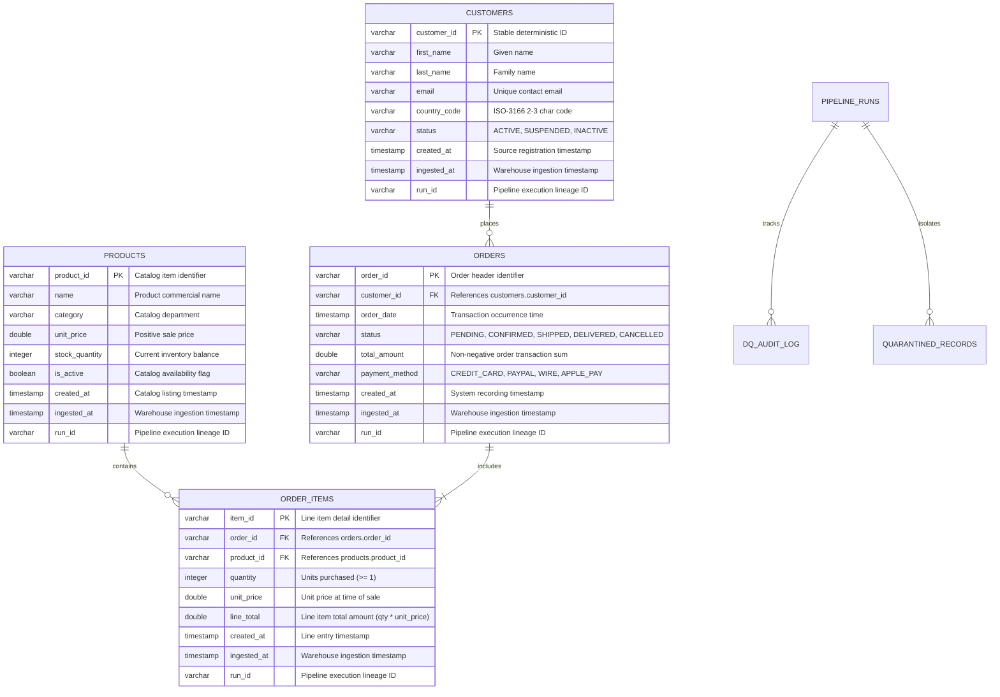

# Data Quality Engine — Data Dictionary & Entity Catalog

## 1. Overview & Architecture Entities
This catalog defines the entity relationship schemas, grains, data types, keys, constraints, nullability, and lineage metadata implemented across the ingestion warehouse.

### Entity Relationship Diagram

---

## 2. Target Business Datasets

### 2.1 Table: `customers`
- **Grain:** One row per registered customer.
- **Deduplication Key:** `customer_id`

| Column Name | Data Type | Nullable | Primary / Foreign Key | Description & Validation Rules |
| :--- | :--- | :--- | :--- | :--- |
| `customer_id` | `VARCHAR` | No | **PK** | Stable deterministic customer identifier (e.g., `CUST_000001`). Must be unique and non-null. |
| `first_name` | `VARCHAR` | Yes | - | Customer's first name. Optional. |
| `last_name` | `VARCHAR` | Yes | - | Customer's last name. Optional. |
| `email` | `VARCHAR` | No | - | Clean, lowercased contact email. Must not be null or empty. |
| `country_code` | `VARCHAR` | No | - | ISO-3166 2 or 3-letter uppercase country code (e.g., `US`, `GB`, `IN`). |
| `status` | `VARCHAR` | No | - | Customer status enum: `ACTIVE`, `SUSPENDED`, `INACTIVE`. |
| `created_at` | `TIMESTAMP` | No | - | ISO-8601 UTC timestamp of customer registration. |
| `ingested_at` | `TIMESTAMP` | No | - | Operational timestamp when record was written to the target warehouse. |
| `run_id` | `VARCHAR` | No | - | Lineage link to `pipeline_runs.run_id`. |

---

### 2.2 Table: `products`
- **Grain:** One row per catalog item.
- **Deduplication Key:** `product_id`

| Column Name | Data Type | Nullable | Primary / Foreign Key | Description & Validation Rules |
| :--- | :--- | :--- | :--- | :--- |
| `product_id` | `VARCHAR` | No | **PK** | Product SKU identifier (e.g., `PROD_00001`). Must be unique. |
| `name` | `VARCHAR` | No | - | Product commercial name. Non-null. |
| `category` | `VARCHAR` | No | - | Uppercase category classification (e.g., `ELECTRONICS`, `APPAREL`). |
| `unit_price` | `DOUBLE` | No | - | Sales price in USD. Range: \$0.01 to \$100,000.00. Strictly positive. |
| `stock_quantity`| `INTEGER` | No | - | Current inventory units. Range: >= 0. |
| `is_active` | `BOOLEAN` | No | - | Boolean flag indicating whether item is actively sold. Default: `TRUE`. |
| `created_at` | `TIMESTAMP` | No | - | ISO-8601 creation timestamp. |
| `ingested_at` | `TIMESTAMP` | No | - | Operational timestamp when record was written to the target warehouse. |
| `run_id` | `VARCHAR` | No | - | Lineage link to `pipeline_runs.run_id`. |

---

### 2.3 Table: `orders`
- **Grain:** One row per order header transaction.
- **Deduplication Key:** `order_id`

| Column Name | Data Type | Nullable | Primary / Foreign Key | Description & Validation Rules |
| :--- | :--- | :--- | :--- | :--- |
| `order_id` | `VARCHAR` | No | **PK** | Order header identifier (e.g., `ORD_0000001`). Must be unique. |
| `customer_id` | `VARCHAR` | No | **FK** | Foreign key referencing `customers.customer_id`. Referential integrity strictly enforced. |
| `order_date` | `TIMESTAMP` | No | - | Timestamp of checkout. Freshness rules: cannot be future-dated, nor older than 730 days. |
| `status` | `VARCHAR` | No | - | Order lifecycle state: `PENDING`, `CONFIRMED`, `SHIPPED`, `DELIVERED`, `CANCELLED`. |
| `total_amount` | `DOUBLE` | No | - | Order monetary value in USD. Range: >= 0.00. |
| `payment_method`| `VARCHAR` | Yes | - | Payment channel: `CREDIT_CARD`, `PAYPAL`, `WIRE`, `APPLE_PAY`. |
| `created_at` | `TIMESTAMP` | No | - | Record creation timestamp. |
| `ingested_at` | `TIMESTAMP` | No | - | Operational timestamp when record was written to the target warehouse. |
| `run_id` | `VARCHAR` | No | - | Lineage link to `pipeline_runs.run_id`. |

---

### 2.4 Table: `order_items`
- **Grain:** One row per individual item line within an order.
- **Deduplication Key:** `item_id`

| Column Name | Data Type | Nullable | Primary / Foreign Key | Description & Validation Rules |
| :--- | :--- | :--- | :--- | :--- |
| `item_id` | `VARCHAR` | No | **PK** | Line item unique identifier (e.g., `ITEM_00000001`). |
| `order_id` | `VARCHAR` | No | **FK** | Foreign key referencing `orders.order_id`. |
| `product_id` | `VARCHAR` | No | **FK** | Foreign key referencing `products.product_id`. |
| `quantity` | `INTEGER` | No | - | Units ordered. Range: 1 to 5,000 units. |
| `unit_price` | `DOUBLE` | No | - | Unit price locked at time of order creation. |
| `line_total` | `DOUBLE` | No | - | Custom Business Rule: `abs(line_total - (quantity * unit_price)) < 0.02`. |
| `created_at` | `TIMESTAMP` | No | - | Timestamp of item entry. |
| `ingested_at` | `TIMESTAMP` | No | - | Operational timestamp when record was written to the target warehouse. |
| `run_id` | `VARCHAR` | No | - | Lineage link to `pipeline_runs.run_id`. |

---

## 3. Operational & Observability Metadata Tables

### 3.1 Table: `pipeline_runs`
- **Grain:** One row per executed pipeline batch.

| Column Name | Data Type | Description |
| :--- | :--- | :--- |
| `run_id` | `VARCHAR PK` | Unique run identifier (e.g. `RUN_20261029_182326_40d572`). |
| `pipeline_name` | `VARCHAR` | Logical name of pipeline configuration. |
| `start_time` | `TIMESTAMP` | Execution start timestamp (UTC). |
| `end_time` | `TIMESTAMP` | Execution completion timestamp (UTC). |
| `status` | `VARCHAR` | Run state: `SUCCESS`, `PARTIAL_SUCCESS`, `FAILED`. |
| `input_row_count` | `BIGINT` | Total input records ingested across all source files. |
| `target_row_count` | `BIGINT` | Total clean records successfully published to warehouse. |
| `quarantine_row_count` | `BIGINT` | Total records quarantined due to DQ/schema failures. |
| `warning_count` | `BIGINT` | Total warning-level rule triggers. |
| `error_count` | `BIGINT` | Total error/critical failure triggers. |
| `duration_seconds` | `DOUBLE` | Total end-to-end execution elapsed time. |
| `error_summary` | `VARCHAR` | High-level summary of issues detected during execution. |

---

### 3.2 Table: `dq_audit_log`
- **Grain:** One row per rule evaluated per dataset per pipeline run.

| Column Name | Data Type | Description |
| :--- | :--- | :--- |
| `eval_id` | `VARCHAR PK` | Unique evaluation identifier (UUID). |
| `run_id` | `VARCHAR` | Associated pipeline run ID. |
| `dataset` | `VARCHAR` | Target dataset (`customers`, `products`, `orders`, `order_items`). |
| `rule_id` | `VARCHAR` | Identifier from `dq_rules.yaml` (e.g. `ORD_FRESH_01`). |
| `rule_name` | `VARCHAR` | Human-readable rule title. |
| `rule_type` | `VARCHAR` | Rule type: `completeness`, `uniqueness`, `referential_integrity`, `range`, `freshness`, `custom`. |
| `severity` | `VARCHAR` | Severity level: `INFO`, `WARNING`, `ERROR`, `CRITICAL`. |
| `records_evaluated` | `BIGINT` | Number of rows checked. |
| `records_passed` | `BIGINT` | Number of rows satisfying rule. |
| `records_failed` | `BIGINT` | Number of rows violating rule. |
| `pass_rate` | `DOUBLE` | Passed ratio: $\frac{\text{records\_passed}}{\text{records\_evaluated}}$. |
| `status` | `VARCHAR` | Status: `PASSED`, `WARNING`, `FAILED`. |
| `evaluated_at` | `TIMESTAMP` | Timestamp of evaluation. |

---

### 3.3 Table: `quarantined_records`
- **Grain:** One row per rejected anomalous record.
- **Traceability Guarantee:** Retains original input payload and explicit failure root-cause.

| Column Name | Data Type | Description |
| :--- | :--- | :--- |
| `quarantine_id` | `VARCHAR PK` | Unique rejection ID (e.g., `QUAR_40d572_customers_CUST_ERR_0001_1`). |
| `run_id` | `VARCHAR` | Originating pipeline run ID. |
| `source_dataset` | `VARCHAR` | Source dataset where rejection originated. |
| `source_record_key` | `VARCHAR` | Natural key of rejected record (or file row offset). |
| `rule_id` | `VARCHAR` | Rule that triggered rejection. |
| `rule_name` | `VARCHAR` | Title of failed rule. |
| `severity` | `VARCHAR` | `ERROR` or `CRITICAL`. |
| `failure_reason` | `VARCHAR` | Descriptive diagnostic error message. |
| `raw_record` | `VARCHAR` | Exact verbatim raw JSON payload of the record. |
| `quarantined_at` | `TIMESTAMP` | Timestamp when record was isolated. |
