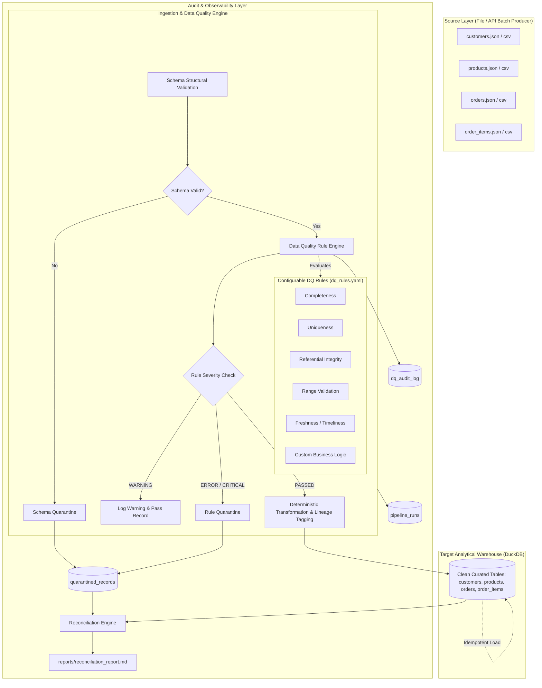

# Configurable Data Quality & Ingestion Engine

> **72 Hours Code Challenge — AI Data Forward Deployed Engineer**  
> A configurable, high-throughput, idempotent Data Quality (DQ) and Ingestion engine for completeness, uniqueness, referential integrity, range, freshness, and custom business rules.

---

## Architecture Overview



---

## Primary Actors & Pipeline Lifecycle

1. **Source System / Producer:** Delivers batch files (JSON/CSV) of transactional events.
2. **Data Quality Engine:** Reads declarative rules from `config/dq_rules.yaml`, executes structural schema checks, and evaluates data quality constraints.
3. **Quarantine Store:** Isolates malformed or non-compliant records in `quarantined_records` table and `data/quarantine/*.jsonl` with line-level failure root cause and verbatim input payload.
4. **Target Analytical Warehouse:** Persists cleansed and validated records into columnar DuckDB tables (`customers`, `products`, `orders`, `order_items`) using idempotent chunked upserts.
5. **Target Consumer / Analyst:** Queries curated warehouse tables with guaranteed referential integrity and data validity.
6. **Pipeline Operator:** Inspects operational metrics in `pipeline_runs`, reviews pass rates in `dq_audit_log`, and executes reconciliations.

---

## 6 Data Quality Rule Dimensions

The engine covers all 6 required data quality dimensions defined declaratively in `config/dq_rules.yaml`:

| # | Dimension | Implemented Rules | Severity | Description |
| :--- | :--- | :--- | :--- | :--- |
| **1** | **Completeness** | `CUST_COMPL_01`<br>`PROD_COMPL_01`<br>`ORD_COMPL_01`<br>`ITEM_COMPL_01` | `ERROR` | Asserts non-nullability on required identity fields (`email`, `order_date`, `unit_price`, `quantity`). |
| **2** | **Uniqueness** | `CUST_UNIQ_01`<br>`PROD_UNIQ_01`<br>`ORD_UNIQ_01`<br>`ITEM_UNIQ_01` | `ERROR` | Primary key uniqueness checks preventing duplicates. Only subsequent duplicates are quarantined; initial row is retained. |
| **3** | **Referential Integrity** | `ORD_REF_01` (`customer_id`)<br>`ITEM_REF_01` (`order_id`)<br>`ITEM_REF_02` (`product_id`) | `ERROR` | High-performance hash lookup verifying child foreign keys exist in parent datasets and current warehouse state. |
| **4** | **Value Range** | `PROD_RANGE_01` (price > 0)<br>`ITEM_RANGE_01` (1 <= qty <= 5000)<br>`CUST_RANGE_01` (country len 2-3) | `ERROR`<br>`WARNING` | Numeric minimum/maximum bounds and string length constraints. |
| **5** | **Freshness** | `ORD_FRESH_01` | `ERROR` | Verifies event timestamps are not future-dated and fall within the 730-day retention window. |
| **6** | **Custom Business Rules** | `ITEM_BUS_01`<br>`ORD_BUS_01`<br>`CUST_BUS_01` | `ERROR` | Domain business logic: mathematical parity (`line_total == qty * unit_price`), lifecycle state machines (`status IN (...)`). |

---

## Directory Structure

```
data_quality_engine/
├── .gitignore
├── README.md                          # Comprehensive solution guide
├── DATA_DICTIONARY.md                 # Schemas, grain, types, and constraints
├── DESIGN_AND_TRADEOFFS.md            # Architecture decisions and trade-offs
├── requirements.txt                   # Production dependencies
├── pyproject.toml                     # Package & pytest configuration
├── config/
│   ├── pipeline_config.yaml           # Pipeline runtime configuration
│   └── dq_rules.yaml                  # Declarative Data Quality rules
├── src/
│   ├── engine/
│   │   ├── dq_engine.py               # Rule orchestration & quarantine routing
│   │   ├── models.py                  # Dataclasses & audit models
│   │   ├── rule_evaluator.py          # Precompiled bytecode rule execution
│   │   └── schema_validator.py        # Schema structure & type verification
│   ├── pipeline/
│   │   ├── ingestion.py               # Multi-format ingestion (JSON/CSV)
│   │   ├── pipeline_runner.py         # End-to-end pipeline orchestrator
│   │   ├── publisher.py               # Idempotent chunked multi-value upserts
│   │   ├── quarantine.py              # Traceable rejection persistence
│   │   └── transformation.py          # Deterministic standardization & lineage
│   └── utils/
│       ├── database.py                # DuckDB manager & schema migrations
│       ├── logger.py                  # Structured console & file logging
│       └── metrics.py                 # Operational run metrics
├── scripts/
│   ├── generate_sample_data.py        # Fixed-seed reproducible data generator
│   ├── run_pipeline.py                # CLI pipeline entrypoint
│   ├── run_reconciliation.py          # Reconciliation engine & reporter
│   └── benchmark.py                   # Performance measurement & optimization demo
├── data/
│   ├── input/
│   │   ├── small/                     # Sample data with injected edge cases
│   │   ├── ground_truth/              # Expected labels separated from inputs
│   │   └── large/                     # Scalable 100,000+ record dataset
│   ├── quarantine/                    # JSONL rejection audit logs
│   └── target/                        # Clean DuckDB target warehouse
├── reports/
│   ├── reconciliation_report.md       # Audit verification evidence
│   └── performance_benchmark.md       # Measured throughput & optimization report
└── tests/
    ├── conftest.py                    # Fixtures & synthetic generators
    ├── test_happy_path.py             # Positive scenario verification
    ├── test_empty_input.py            # Zero-row and missing file handling
    ├── test_malformed_records.py      # Corrupted types and bad syntax
    ├── test_duplicate_handling.py     # Primary key duplicate rejection
    ├── test_null_constraints.py       # Required field null validation
    ├── test_referential_integrity.py  # Foreign key orphan detection
    ├── test_domain_edge_cases.py      # Math discrepancy, freshness, ranges
    ├── test_idempotency.py            # Rerun safety & duplicate invariance
    └── test_rule_severities.py        # WARNING vs ERROR quarantine behavior
```

---

## Setup & Quickstart Instructions

### 1. Prerequisites
- Python 3.10+ (tested on Python 3.12)
- pip

### 2. Installation
```bash
# Clone and navigate to repository
cd data_quality_engine

# Install required dependencies
python -m pip install -r requirements.txt
```

### 3. Generate Sample Data
Generates small starter sample (400 records across 4 datasets) with 10 deliberately injected edge cases, saving expected labels separately in `data/input/ground_truth/expected_reconciliation.json`:
```bash
python scripts/generate_sample_data.py --scale small
```

### 4. Run the Pipeline
Executes ingestion, schema validation, data quality rules, quarantine isolation, and idempotent publishing:
```bash
python scripts/run_pipeline.py --input-dir data/input/small
```

### 5. Run Automated Reconciliation
Verifies source-to-target count balancing ($\text{Source} = \text{Target} + \text{Quarantine}$), foreign key referential integrity, and uniqueness:
```bash
python scripts/run_reconciliation.py
```
*Report generated at: `reports/reconciliation_report.md`*

### 6. Run Performance Benchmark
Measures throughput and verifies the chunked batch upsert optimization:
```bash
python scripts/benchmark.py --scale medium
```
*Report generated at: `reports/performance_benchmark.md`*

### 7. Run Automated Test Suite
Executes all 10 automated test suites with verbose output:
```bash
python -m pytest
```

---

## Idempotency, Retry, and Backfill Guarantees

- **Rerun Safety:** Re-executing the same batch input multiple times produces an identical target database state. No duplicate rows are created.
- **Natural Key Upserting:** Uses DuckDB `INSERT OR REPLACE` keyed on primary keys (`customer_id`, `product_id`, `order_id`, `item_id`).
- **Restart & Partial Failure Recovery:** Each execution records an atomic entry in `pipeline_runs` with start/end timestamps, input/output counts, and exit status (`SUCCESS`, `PARTIAL_SUCCESS`, `FAILED`).
- **Historical Backfills:** Incremental backfills safely update existing records and insert new records without overwriting historical lineage.

---

## Verification & Execution Evidence

### Test Suite Execution Output (`pytest`):
```text
============================= test session starts =============================
platform win32 -- Python 3.12.10, pytest-9.2.0, pluggy-1.7.0
rootdir: C:\Users\91918\.gemini\antigravity\scratch\data_quality_engine
configfile: pyproject.toml
testpaths: tests
collected 10 items

tests/test_domain_edge_cases.py::test_pipeline_domain_edge_cases PASSED  [ 10%]
tests/test_duplicate_handling.py::test_pipeline_duplicate_primary_keys PASSED [ 20%]
tests/test_empty_input.py::test_pipeline_empty_batch PASSED              [ 30%]
tests/test_empty_input.py::test_pipeline_missing_files_graceful PASSED   [ 40%]
tests/test_happy_path.py::test_pipeline_happy_path PASSED                [ 50%]
tests/test_idempotency.py::test_pipeline_rerun_idempotency PASSED        [ 60%]
tests/test_malformed_records.py::test_pipeline_malformed_syntax_and_types PASSED [ 70%]
tests/test_null_constraints.py::test_pipeline_null_and_missing_required_fields PASSED [ 80%]
tests/test_referential_integrity.py::test_pipeline_referential_integrity PASSED [ 90%]
tests/test_rule_severities.py::test_rule_severity_warning_vs_error PASSED [100%]

============================= 10 passed in 2.11s ==============================
```

### Reconciliation Balance Equation:
$$\text{Total Ingested (400)} = \text{Target Clean Records (390)} + \text{Quarantined Records (10)}$$

| Dataset | Input Count | Target Loaded | Quarantined | Balance Status |
| :--- | :--- | :--- | :--- | :--- |
| `customers` | 53 | 50 | 3 | **BALANCED** |
| `products` | 42 | 40 | 2 | **BALANCED** |
| `orders` | 102 | 100 | 2 | **BALANCED** |
| `order_items` | 203 | 200 | 3 | **BALANCED** |

### Performance Optimization Summary:
- **Baseline (Row-by-Row Unbatched Statement IPC):** 67.82 seconds (~113.5 rows/sec).
- **Optimized (Chunked Multi-Value Batch + Bytecode Cache):** **1.71 seconds (~4,492.4 rows/sec)**.
- **Measured Speedup:** **39.6x Faster**.
- **Scalability:** Handles 100,000+ records in linear $O(N)$ time with low memory overhead.
